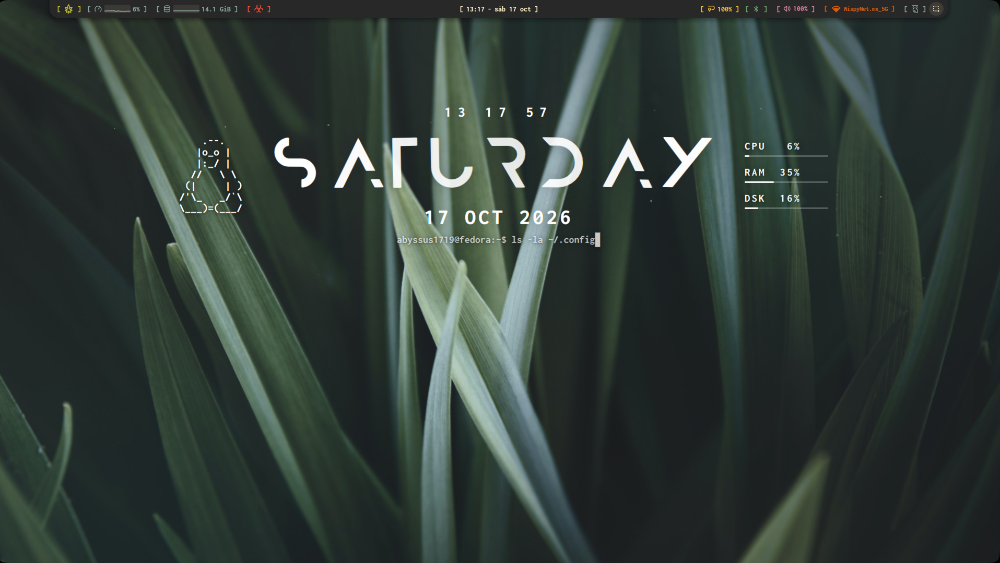

<pre>
                                                                      ,'''''.
                                                                     |   ,.  |
                          ______         __                          |  |  '_'
                         / ____/__  ____/ /___  _________ _     ,....|  |..
                        / /_  / _ \/ __  / __ \/ ___/ __ `/   .'  ,_;|   ..'
                       / __/ /  __/ /_/ / /_/ / /  / /_/ /    |  |   |  |
                      /_/    \___/\__,_/\____/_/   \__,_/     |  ',_,'  |
                                                               '.     ,'
                                                                 '''''
</pre>

<div align="center">

# Fedora Linux - Dotfiles

Repositorio de configuraciones personales para el compositor de ventanas Hyprland, meticulosamente optimizadas y adaptadas para la arquitectura y el rendimiento de la laptop Huawei MateBook D16 bajo el sistema operativo Fedora Linux.

Este entorno ha sido diseñado con el propósito de consolidar un espacio de trabajo de alto rendimiento, fluido y visualmente cohesivo dentro del ecosistema nativo de Wayland. El núcleo de esta personalización integra una configuración modular de Noctalia Shell como interfaz y panel principal del sistema, el emulador de terminal Wezterm optimizado para una respuesta inmediata, y el lanzador dinámico Rofi adaptado estéticamente para una navegación ágil y sin fricciones.

El resultado es un sistema minimalista, eficiente en el consumo de recursos y adaptado al hardware diario.


---

</div>

<div align="center">

### Vista previa

</div>
<p align="center">
  <br><br>
</p>

## Estructura del Proyecto

```
Fedora-Dotfiles/
├── .config/
│   ├── fastfetch/
│   │   ├── logos/
│   │   └── config.jsonc
│   ├── hypr/
│   │   └── scripts/
│   │       ├── flotantes.sh
│   │       ├── opacity.sh
│   │       └── hyprland.lua
│   ├── kitty/
│   │   └── kitty.conf
│   ├── quickshell / Reloj/
│   │   └── shell.qml
│   ├── rofi/
│   │   ├── config.rasi
│   │   ├── launcher.sh
│   │   └── style-3.rasi
│   ├── wezterm/
│   │   ├── charmful.lua
│   │   └── wezterm.lua
│   └── starship.toml
├── assets/
├── Noctalia/
│   └── noctalia-config.toml
├── Wallpaper/
│   └── Hierva.jpg
├── zsh/
│   └── .zshrc
├── LICENSE
└── README.md
```
